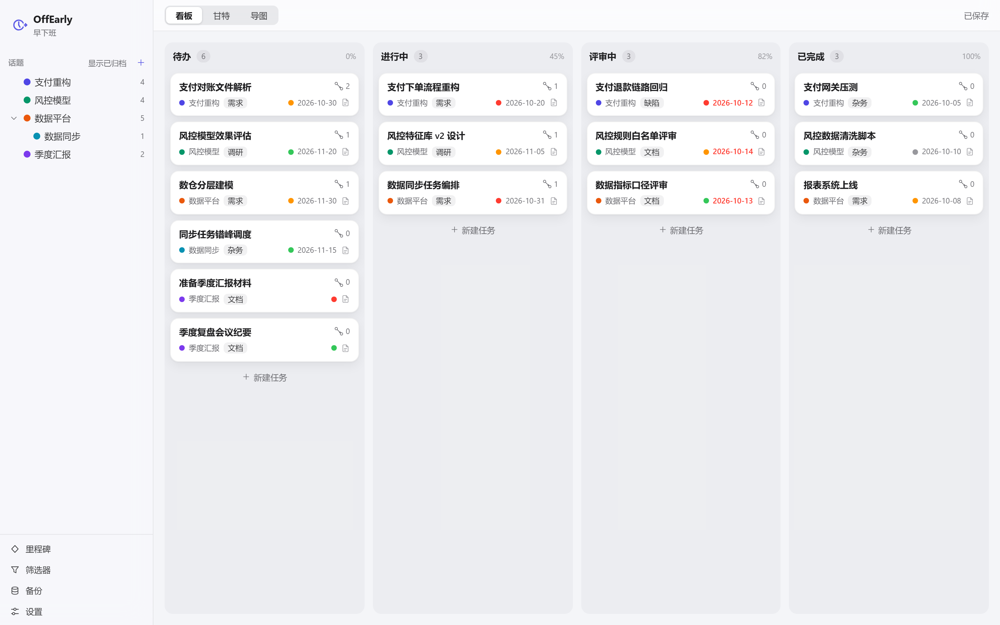

# OffEarly（早下班）

> 把事做完，早点下班。 / Finish well. Leave early.

**[在线体验](https://miraclewt.github.io/OffEarly/OffEarly.html)** · **[项目主页](https://miraclewt.github.io/OffEarly/)** · [用户手册](docs/user-guide.md) · [交付说明](docs/delivery.md)



OffEarly 是一个**单文件、离线、数据自持**的个人任务管理工具：看板 + 甘特图 + 思维导图三视图合一，交付物就是一个 HTML 文件——双击 `dist/OffEarly.html` 即可运行，不需要服务器、不联网、零外部请求，所有数据都存在你自己选定的文件夹里。

## 特性一览

- **单文件交付**：`OffEarly.html` 约 1.1 MB，无任何外链 script / link / 远程资源，`file://` 直接打开
- **数据自持**：数据库是一个可读可手改的纯 JSON（`vault.json`），图片附件在 `assets/`，换电脑拷走文件夹即可；没有账号、没有云端、没有遥测
- **看板**：固定四列，卡片拖拽换列，列底「+ 新建任务」支持回车连续录入
- **甘特图**：依赖箭头、关键路径、基线、日/周刻度、工作日历驱动的工期计算；任务条上直接显示任务名；左侧任务表与右侧未排期面板可折叠；导出 PNG / SVG / CSV（仅可见区或全时间跨度）
- **思维导图**：xmind 逻辑图·向右，键盘建树（`Tab` 子 / `Enter` 同 / `F2` 改名 / `Space` 折叠 / 方向键游走）、跨父拖拽改挂、折叠 `+N` 徽标、平移缩放（50%–300%）、导出 PNG / SVG
- **笔记**：任务详情内置 Markdown 编辑器，支持图片粘贴/拖入（存 `assets/`、灯箱查看）与 `[[双向链接]]` 跳转
- **任务详情弹窗**：标题 / 属性（状态、类别、优先级、负责人、话题、标签）/ 日期与进度 / 依赖关系（模糊搜索建链、成环标红）/ 笔记，五分区集中编辑
- **数据安全**：每次保存前逐字节快照到 `.backup/`；启动自愈（库损坏自动回退最近快照进只读安全模式）；外部改动冲突三选（以我为准 / 以磁盘为准 / 导出我的副本）；备份面板支持快照列表、恢复、导出库副本、导入、未引用附件清理
- **撤销 / 重做**：所有改动进命令总线撤销栈，`Ctrl+Z` 随时回退
- **中英双语**：设置面板可切换语言（跟随系统 / 中文 / English），即时生效

## 快速上手

1. 下载 [`OffEarly.html`](https://github.com/miraclewt/OffEarly/releases/latest/download/OffEarly.html) 双击打开；源码用户改成先 `npm run build`，再双击 `dist/OffEarly.html`
2. 首次打开点「选择文件夹」，选一个空目录（会询问是否在此创建新库），或直接用仓库自带的 `example.vault/` 试玩——里面有 5 个话题、15 个任务、3 个里程碑、7 条依赖和 1 张配图笔记，覆盖全部状态与逾期 / 被阻塞 / 未排期场景
3. 之后每次打开自动记住并连接该文件夹（重开只需点一次「授权并继续」）

改动自动保存，顶部右侧有三态保存指示（已保存 / 未保存 / 保存失败，失败可重试）；要立刻落盘按 `Ctrl+S`（macOS 为 `Cmd+S`）。

**浏览器要求**：需支持 File System Access API——Chrome / Edge 113+。Safari、Firefox 不支持。

## 数据文件夹结构

```
<你选择的文件夹>
├── vault.json     唯一的数据库（纯 JSON，可手改；改前请先备份）
├── assets/        图片附件
└── .backup/       每次保存前的自动快照
```

## 开发

```bash
npm install          # 安装依赖
npm run dev          # Vite 开发服务器
npm test             # Vitest 单元测试（tests/ 下，jsdom / node）
npm run e2e          # Playwright 端到端测试（真实 Chromium 跑 file://）
npm run build        # 构建：lint:emoji → tsc --noEmit → vite build → 产物校验
npm run capture      # 刷新落地页素材：抓 4 张真实界面图 + 把产物拷进 site/
npm run preview      # 预览构建产物
```

构建管线内置了十项产物校验（`npm run verify`）：单文件、零外链、favicon 内联、禁 emoji 等，全部通过才产出 `dist/OffEarly.html`。

`npm run capture` 依赖已存在的 `dist/OffEarly.html`，所以先 `npm run build` 再跑它。

## 发版

推一个 `v*` tag 就行，Actions 会自己构建并发布成 GitHub Release：

```bash
git tag -a v0.1.0 -m "第一个正式版" -m "这里写的会变成 Release 说明"
git push origin v0.1.0
```

`.github/workflows/release.yml` 跑 `npm ci && npm run build`（含 `tsc --noEmit` 和十项产物校验），把 `dist/OffEarly.html` 作为唯一附件传上去，之后下载链永久有效：

```
https://github.com/miraclewt/OffEarly/releases/latest/download/OffEarly.html
```

只在推 tag 时触发，普通 push 不跑；不需要 PAT 也不需要配 secret，用工作流自带的 `GITHUB_TOKEN`。
`npm version 0.1.0` 也能一次改版本号加打 tag，但它要求工作区干净，多人共用 worktree 时容易失败，手打 tag 更稳。

## 项目结构

```
src/
├── App.tsx / main.tsx        应用入口
├── domain/                   领域层：schema、store、命令总线、查询引擎、
│                             排期引擎、甘特/导图模型、LexoRank 排序、依赖图
├── controllers/              用例层：任务创建、话题操作、导图动作、筛选、
│                             甘特/导图视口、备份 GC、设置动作
├── persistence/              持久层：File System Access 适配、自动保存、
│                             快照、备份 IO、库仓储、句柄存储
├── views/                    React 视图：看板 / 甘特 / 思维导图 / 各类面板与弹窗
├── locales/                  中英文文案
└── styles/                   主题与样式（theme.css 为视觉 token 唯一来源）
tests/                        单元测试（按 domain / controllers / persistence / views 分层）
e2e/                          Playwright 用例（01 启动 → 09 思维导图）
capture/                      落地页素材抓取（独立 Playwright 配置，不混进回归套件）
site/                         落地页：单文件 index.html + 截图 + 随站产物，Pages 发布这个目录
.github/workflows/            Pages 部署 + Release 发布工作流
scripts/                      构建校验、禁 emoji 检查、冲突处理脚本
docs/                         交付说明、用户手册、视觉审计、设计稿
brand/                        图标与 Logo
example.vault/                示例库（可直接连接试玩）
```

## 技术栈

React 19 · TypeScript · Vite 8（vite-plugin-singlefile 打单文件）· Zustand · Tiptap 3（Markdown 笔记）· dnd-kit（看板拖拽）· Zod（schema 校验）· dayjs · Vitest · Playwright

## 文档

- [docs/user-guide.md](docs/user-guide.md) —— 中英双栏一页纸用户手册（17 个主题：操作步骤、快捷键、导出、边界说明）
- [docs/delivery.md](docs/delivery.md) —— 交付说明与验收证据（类型检查 / 931 单测 / 38 e2e / 产物校验）
- [docs/visual-audit.md](docs/visual-audit.md) —— 视觉审计（方案 A · macOS 通透，强调色系统靛 `#5E5CE6`）

## 本版范围边界

已实现：三视图、任务详情弹窗、笔记（图片 + 双链）、思维导图（T40–T48）、里程碑 / 筛选 / 备份 / 设置面板、图表导出。

不在范围内：多端实时协同（仅冲突三选 + 30s 轮询）、看板列自定义（固定四列）、甘特拖拽改期（只读投影，日期在弹窗里改）、撤销 / 重做快捷键绑定、导图节点与任务关联（导图独立成树）。

## 许可证

[MIT](LICENSE) —— 用、改、再分发都行，闭源也可以，保留版权与许可声明即可。
