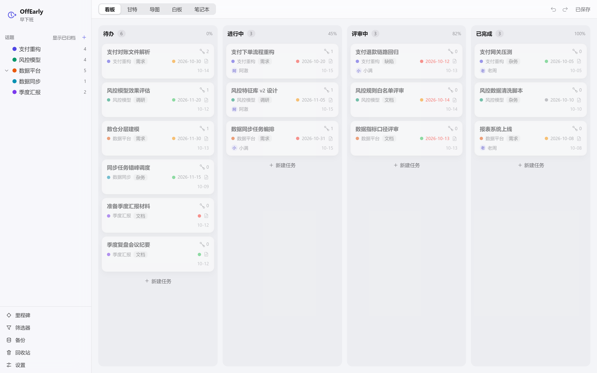

# OffEarly（早下班）

> 把事做完，早点下班。 / Finish well. Leave early.

**[在线体验](https://miraclewt.github.io/OffEarly/OffEarly.html)** · **[项目主页](https://miraclewt.github.io/OffEarly/)** · [用户手册](docs/user-guide.md) · [交付说明](docs/delivery.md)



OffEarly 是一个**单文件、离线、数据自持**的个人工作台：看板、甘特图、思维导图、知识库、白板五视图合一，交付物就是一个 HTML 文件——双击 `dist/OffEarly.html` 即可运行，不需要服务器、不联网、零外部请求，所有数据都存在你自己选定的文件夹里。

> **浏览器硬要求**：桌面版 **Chrome / Edge 113+**（需 File System Access API）。Safari、Firefox 与手机浏览器不支持。这是读写本机数据文件夹的前提，不是可选项——下载前请先确认。

## 特性一览

- **单文件交付**：`OffEarly.html` 约 6.3 MB（v0.9.2 为 6,564,573 字节），无任何外链 script / link / 远程资源，`file://` 直接打开
- **数据自持**：数据库是一个可读可手改的纯 JSON（`vault.json`），图片附件在 `assets/`，换电脑拷走文件夹即可；没有账号、没有云端、没有遥测
- **看板**：固定四列，卡片拖拽换列，列底「+ 新建任务」支持回车连续录入
- **甘特图**：依赖箭头、关键路径、日/周刻度、工作日历驱动的工期计算；任务条上直接显示任务名；左侧任务表与右侧未排期面板可折叠；导出 PNG / SVG / CSV（仅可见区或全时间跨度）
- **思维导图**：xmind 逻辑图·向右，键盘建树（`Tab` 子 / `Enter` 同 / `F2` 改名 / `Space` 折叠 / 方向键游走）、跨父拖拽改挂、折叠 `+N` 徽标、平移缩放（50%–300%）、导出 PNG / SVG
- **知识库**：文档树 + 笔记本切换器；Markdown 编辑器支持 `/` 斜杠命令、表格行列工具条、代码块着色、mermaid、图片粘贴拖入、`[[双向链接]]`；大纲与反向链接、按 H2 分页的展示模式、导出 `.md` / HTML、正文宽度三档（窄 / 适中 / 全宽）
- **白板**：八种图元 + 贴图、正交/直线连线、四套模板、自定义色与字号、对齐 / 等距分布 / 移到视野中心、导出 PNG / SVG
- **把外部信息收进来**：从 Outlook 导出的 `.ics` 生成带「决议 / 待办」结构的会议笔记（同一份重复导入不会重复建篇）；批量导入 `.md` / `.txt`，AI 生成的笔记可直接入库，front matter、标题与标签自动识别
- **找得到、改得回**：`Ctrl/Cmd + K` 全局搜索把任务 / 文档 / 命令汇到一处；全局撤销 / 重做（`Ctrl+Z` / `Ctrl+Shift+Z` / `Ctrl+Y`）；任务与笔记回收站可预览、恢复、彻底删除
- **任务详情弹窗**：标题 / 属性（状态、类别、优先级、负责人、话题、标签）/ 日期与进度 / 依赖关系（模糊搜索建链、成环标红）/ 内置 Markdown 笔记，五分区集中编辑
- **数据安全**：每次保存前逐字节快照到 `.backup/`（按最近份数 + 每日首份轮转保留）；启动自愈（库损坏自动回退最近快照进只读安全模式）；外部改动冲突三选（以我为准 / 以磁盘为准 / 导出我的副本）；备份面板支持快照列表、恢复、导出库副本、导入、未引用附件清理
- **中英双语**：设置面板可切换语言（跟随系统 / 中文 / English），即时生效

## 快速上手

1. 下载 [`OffEarly.html`](https://github.com/miraclewt/OffEarly/releases/latest/download/OffEarly.html) 双击打开；源码用户改成先 `npm run build`，再双击 `dist/OffEarly.html`
2. 首次打开点「选择文件夹」，选一个空目录（会询问是否在此创建新库），或直接用仓库自带的 `example.vault/` 试玩——里面有 5 个话题、15 个任务、3 个里程碑、7 条依赖、2 本笔记本 / 4 篇文档和 1 张配图笔记，覆盖全部状态与逾期 / 被阻塞 / 未排期场景；空库时看板顶部有可点的「新建话题」按钮
3. 之后每次打开自动记住并连接该文件夹（`file://` 下重开需点一次「授权并继续」）

改动自动保存，顶部右侧有三态保存指示（已保存 / 未保存 / 保存失败，失败可重试）；要立刻落盘按 `Ctrl+S`（macOS 为 `Cmd+S`）。

## 数据文件夹结构

```
<你选择的文件夹>
├── vault.json     唯一的数据库（纯 JSON，可手改；改前请先备份）
├── assets/        图片附件
└── .backup/       每次保存前的自动快照
```

## 开发

```bash
npm install          # 安装依赖
npm run dev          # Vite 开发服务器
npm test             # Vitest 单元测试（tests/ 下，jsdom / node）
npm run e2e          # Playwright 端到端测试（真实 Chromium 跑 file://）
npm run build        # 构建：lint:emoji → tsc --noEmit → vite build → 产物校验
npm run capture      # 刷新落地页素材：抓 4 张真实界面图 + 把产物拷进 site/（每次发版后必跑）
npm run preview      # 预览构建产物
```

构建管线内置了十一项产物校验（`npm run verify`）：单文件、零外链、favicon 内联且与 `brand/favicon.svg` 逐字节一致、禁 emoji 等，全部通过才产出 `dist/OffEarly.html`。

`npm run capture` 依赖已存在的 `dist/OffEarly.html`，所以先 `npm run build` 再跑它。**落地页的「打开在线版」指向 `site/OffEarly.html`，它是 `capture` 从 `dist/` 拷进去的快照；漏跑这一步，线上体验会一直停在旧版本**（v0.1.0 就曾这样留了八个版本）。

## 发版

推一个 `v*` tag 就行，Actions 会自己构建并发布成 GitHub Release：

```bash
git tag -a v0.1.0 -m "第一个正式版" -m "这里写的会变成 Release 说明"
git push origin v0.1.0
```

`.github/workflows/release.yml` 跑 `npm ci && npm run build`（含 `tsc --noEmit` 和十一项产物校验），把 `dist/OffEarly.html` 作为唯一附件传上去，之后下载链永久有效：

```
https://github.com/miraclewt/OffEarly/releases/latest/download/OffEarly.html
```

只在推 tag 时触发，普通 push 不跑；不需要 PAT 也不需要配 secret，用工作流自带的 `GITHUB_TOKEN`。
`npm version 0.1.0` 也能一次改版本号加打 tag，但它要求工作区干净，多人共用 worktree 时容易失败，手打 tag 更稳。

## 项目结构

```
src/
├── App.tsx / main.tsx        应用入口
├── domain/                   领域层：schema、store、命令总线、查询引擎、
│                             排期引擎、甘特/导图模型、LexoRank 排序、依赖图
├── controllers/              用例层：任务创建、话题操作、导图动作、筛选、
│                             甘特/导图视口、备份 GC、设置动作
├── persistence/              持久层：File System Access 适配、自动保存、
│                             快照、备份 IO、库仓储、句柄存储
├── views/                    React 视图：看板 / 甘特 / 思维导图 / 各类面板与弹窗
├── locales/                  中英文文案
└── styles/                   主题与样式（theme.css 为视觉 token 唯一来源）
tests/                        单元测试（按 domain / controllers / persistence / views 分层）
e2e/                          16 个 Playwright spec（启动 / 保存 / 冲突 / 甘特 / 导出 / 笔记 / 会议导入 / 回收站 / 白板 / Markdown 导入 …），跑真实 file:// 单文件
capture/                      落地页素材抓取（独立 Playwright 配置，不混进回归套件）
site/                         落地页：index.html + 4 张真实界面图 + 随站产物 OffEarly.html，Pages 发布这个目录
.github/workflows/            Pages 部署 + Release 发布工作流
scripts/                      构建校验、禁 emoji 检查、冲突处理脚本
docs/                         交付说明、用户手册、视觉审计、设计稿
brand/                        图标与 Logo
example.vault/                示例库（可直接连接试玩）
```

## 技术栈

React 19 · TypeScript · Vite 8（vite-plugin-singlefile 打单文件）· Zustand · Tiptap 3（Markdown 笔记）· dnd-kit（看板拖拽）· Zod（schema 校验）· dayjs · Vitest · Playwright

## 文档

- [docs/user-guide.md](docs/user-guide.md) —— 中英双栏一页纸用户手册（操作步骤、快捷键、导出、边界说明）
- [docs/delivery.md](docs/delivery.md) —— 交付说明与验收证据（对应早期版本；当前基线见下节）
- [docs/visual-audit.md](docs/visual-audit.md) —— 视觉审计（方案 A · macOS 通透，强调色系统靛 `#5E5CE6`）

## 当前基线（v0.9.2）

| 关口 | 结果 |
|---|---|
| 类型检查 | `npx tsc --noEmit` 0 |
| 单元 / 组件 | `npm test` 1581 passed (85 files) |
| 端到端 | `npx playwright test --trace=off` 90 passed + 1 skipped |
| 构建 | `npm run build` 11/11 项产物校验通过，6,564,573 字节 |

逐次发版与验收自检见 `task.md` 文末《完成记录》。

## 产品边界与迭代准则

**服务谁**：一台电脑上、一个人、对数据主权敏感的知识工作者（内网 / 断网 / 涉密 / 项目归档）。这不是「还没做协同」，是主动不做的取舍。

**北极星指标**：`每周 ≥3 天发生任务状态变更`。选它是因为 OffEarly 的承诺是「把事做完，早点下班」——只有被持续用来推进任务才算兑现；新增视图、编辑器手感、导出格式都不直接计入。

> 产品无遥测、无账号、无云端，**这个指标无法自动采集**。它是需求裁决时的判据，不是看板上的数字：评估靠用户回访与本地 `vault.json` 的离线自检（时间戳 / 状态变更痕迹），不引入任何埋点。

**明确不做**（写死，避免用户带着 Notion 预期进来）：

- 多人协同 / 实时同步 / 跨设备云同步（现有「冲突三选 + 30s 轮询」只防两个窗口互相覆盖，不是同步）
- 移动端 / 触屏专项适配
- 桌面壳（Electron / Tauri 已两次否决）
- 账号、云端、遥测、后台到期提醒推送
- 第六个视图

**白板能力冻结**：白板只用于「在一张图里画清架构草图 / 流程 / 框架」，不与 draw.io、Excalidraw、FigJam 比功能。以下一律不排期：新增图元类型与形状语法、图层 / 嵌套分组 / 复杂连线路由、自动布局与进阶吸附对齐、多人光标与评论、图元与任务的双向绑定、白板触屏手势专项。此后只接受两类改动——数据正确性缺陷（P1）与明显可用性阻断；「更好用」类增量需求排队或拒绝。

**需求裁剪规则**：任何新需求先回答三问——① 它是否让「每周 ≥3 天有任务状态变更」更可能发生？② 它是否只改善某个边缘视图的局部手感？③ 它会牺牲单文件 / 零外链 / 数据自持中的哪一条？① 为否且 ② 为是 → 不排期；③ 有牺牲 → 直接否决。

**当前已知限制**：看板固定四列不可自定义；甘特是只读投影，改期在任务弹窗里做；思维导图独立成树，不与任务关联；会议导入生成的是笔记而非任务，待办不会自动进看板；逾期只在打开应用后标红 / 筛选，没有后台提醒。

## 许可证

[MIT](LICENSE) —— 用、改、再分发都行，闭源也可以，保留版权与许可声明即可。
